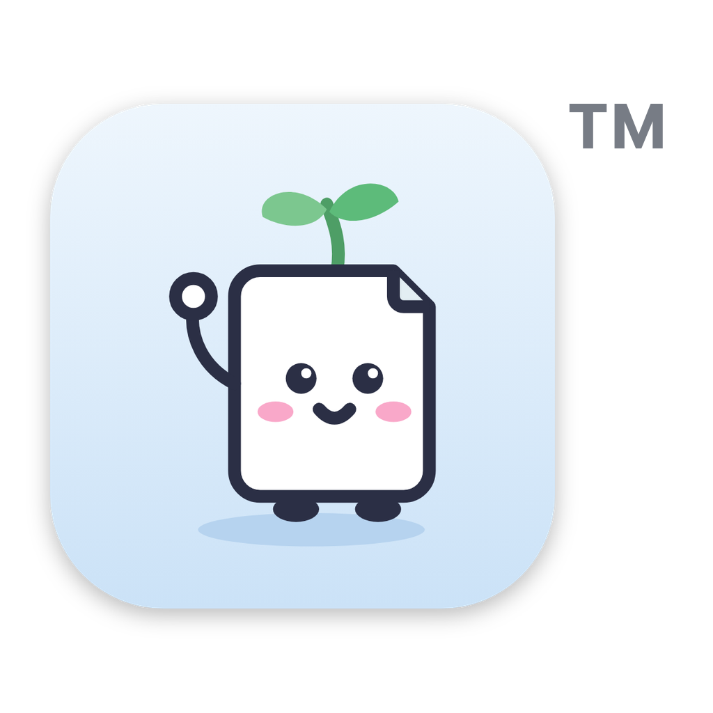

Slipbox is a free Mac app for keeping a Zettelkasten: short notes in your own words, each one a plain Markdown file in a folder you choose, linked into a web of ideas that grows with your work. Version 5.4.0 brings in notes from other apps, lets any note join a thread and any thread branch, and lets you choose how much history to keep.

## Download

**Slipbox-5.4.0.dmg** (108 MB, below under Assets). Needs macOS 11 or later. Built for Apple-silicon and Intel Macs; tested so far on Apple silicon.

SHA-256: `612de0183809d00c7323e7e7dde99f188aaf434e70389e6ac9b32408db52890e`

To check your download, run `shasum -a 256 ~/Downloads/Slipbox-5.4.0.dmg` in Terminal and compare the result with the line above.

## Installing or updating

1. Open the `.dmg` and drag **Slipbox** onto **Applications**. If you have an earlier version, choose **Replace**.
2. Open Slipbox from Applications. The first time, macOS asks whether you want to open an app downloaded from the internet; click **Open**.

Your notes, settings, note history and locked-notes key are not inside the app, so replacing it leaves them as they are. Full guide: [INSTALL.md](https://github.com/shivissar/Slipbox/blob/main/INSTALL.md).

## In this version

- **Import notes from another app.** Settings → Import notes brings in Markdown files from an Obsidian vault, Zettlr or Bear notes, a Notion export or any folder, subfolders included. They are copied, never changed. Each becomes a note with its title, its tags plus `imported`, and its dates; links between the files become Slipbox links. You see what will happen, including any links that can't be matched, before anything is imported. Pictures and other attachments aren't copied. One import takes up to 2,000 files.
- **Threads for every note.** Open a note you've already written and choose **Add to a thread** in the side panel, picking the thread and the note it should follow. On a thread's page, add notes, move them with ↑ and ↓, or take one out; the notes either side are joined up. Notes of any kind can be in threads, and a note can be in several.
- **Threads that branch.** From any note in a thread, a second line of thought can leave as a branch while the thread carries on, and a branch can branch again, ten levels deep. Start one with a new note, a note you've written, the rest of the thread (which splits it in two) or a thread you already have. A thread's page draws its branches under the notes they leave, numbered as Luhmann numbered his cards (3, 3a, 3a1).
- **Choose how much history to keep.** Settings → Trash and history sets how many earlier versions of each note are kept (10 to 200) and shows how much space the history uses. More versions take more space. If you used an earlier version, it keeps 200 until you change it; new installs keep 50.
- **Manuscripts you build on the page.** A manuscript is where notes are assembled into one text. A new one now opens on its own page, where you name it and add notes, a whole thread or section headings; reorder them in the side panel, and press Edit to write around them.
- **Smaller things.** Fields that other apps add to a note's front matter are kept when Slipbox saves the note. The update page no longer shows the release notes' logo as code. A bibliography that Zotero saves by replacing the whole file is picked up, and Settings → Bibliography shows how many references are in use, or says if the file has been renamed or moved.

## Licences

Slipbox: PolyForm Noncommercial 1.0.0 (free for personal, academic and non-profit use). The app bundles pandoc 3.1.13 (GPL-2.0-or-later); its source is attached below as `pandoc-3.1.13-source.tar.gz` and is at https://github.com/jgm/pandoc/releases/tag/3.1.13. The version of numpy in this build no longer includes libquadmath, so that source archive is not attached. See [THIRD-PARTY-NOTICES.md](https://github.com/shivissar/Slipbox/blob/main/THIRD-PARTY-NOTICES.md).

