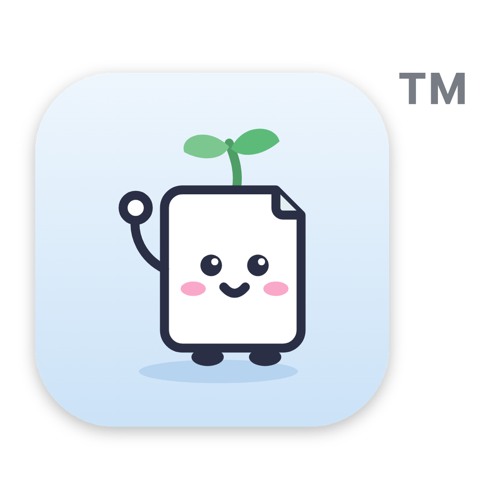

Slipbox is a free Mac app for keeping a Zettelkasten: short notes in your own words, each one a plain Markdown file in a folder you choose, linked into a web of ideas that grows with your work. It was called Zetteling until this version.

## Download

**Slipbox-5.2.0.dmg** (111 MB, below under Assets). Needs macOS 11 or later. Built for Apple-silicon and Intel Macs; tested so far on Apple silicon.

SHA-256: `bca33d03102f7c3e9321c11f9b4211b7c60c2f705dd1cc2fdd15ce2f3a0a654a`

To check your download, run `shasum -a 256 ~/Downloads/Slipbox-5.2.0.dmg` in Terminal and compare the result with the line above.

## Installing

1. Open the `.dmg` and drag **Slipbox** onto **Applications**.
2. Open Slipbox from Applications. macOS asks whether you want to open an app downloaded from the internet; click **Open**.

Slipbox is signed with a Developer ID and notarised by Apple, so there is no Open Anyway step and no Terminal command. Full guide: [INSTALL.md](https://github.com/shivissar/Slipbox/blob/main/INSTALL.md).

## Coming from Zetteling

Install Slipbox and open it. The first time, it moves your settings, search index, note history and locked-notes key across from Zetteling, and says so. Your notes folder stays where it is. Then drag the old Zetteling app to the Bin.

If the same notes folder is also used on another Mac, install Slipbox there too before opening locked notes on it: Zetteling can't find the renamed locked-notes key.

## In this version

This is the first public release, so it includes everything since Zetteling 5.0:

- **One window:** sidebar, note list, the note, and a side panel with its thread, backlinks and related notes.
- **Linking and citing:** `[[` to link a note and `@` to cite from Zotero, at the cursor; ⌘K finds any note or runs any command.
- **Research tools:** note history with one-click restore; backlinks with the sentence around each link; unlinked mentions; templates for interview memos, fieldnotes, reading notes and lecture plans; qualitative coding with a Codebook and CSV export; manuscripts; search filters such as `kind:`, `tag:`, `code:` and `after:`.
- **Locked notes:** encrypt a note, or every note of a kind, on your Mac with a password and a recovery key. Locked notes are never sent to an AI provider.
- **Autosave** while you write, and on quit.
- **Export** to Word, LaTeX, HTML, OpenDocument and EPUB with the bundled pandoc, with formatted citations.
- **Your look:** seven light and dark themes, fonts, text sizes and accent colours.
- **Optional AI** (Anthropic, OpenAI-compatible services, Google Gemini, Voyage AI or Ollama on your Mac), off until you set it up.
- **Help, a short tour, and update notices.** Slipbox tells you when a new version is out but never downloads or installs anything by itself.

## Licences

Slipbox: PolyForm Noncommercial 1.0.0 (free for personal, academic and non-profit use). The app bundles pandoc 3.1.13 (GPL-2.0-or-later); its source is attached below as `pandoc-3.1.13-source.tar.gz` and is at https://github.com/jgm/pandoc/releases/tag/3.1.13. numpy's bundled libquadmath (LGPL-2.1-or-later) comes from GCC; its source is attached below as well. See [THIRD-PARTY-NOTICES.md](https://github.com/shivissar/Slipbox/blob/main/THIRD-PARTY-NOTICES.md).
